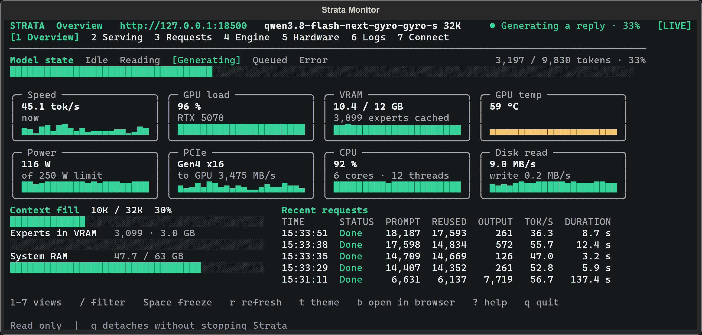

<p align="center">
  <picture>
    <source media="(prefers-color-scheme: dark)" srcset="apps/host/public/brand/strata-lockup-dark.svg">
    
  </picture>
</p>

<p align="center"><b>English</b> · <a href="README.zh-CN.md">简体中文</a> · <a href="README.ja.md">日本語</a> · <a href="README.de.md">Deutsch</a> · <a href="README.fr.md">Français</a> · <a href="README.es.md">Español</a> · <a href="README.pt-BR.md">Português</a></p>

> **This is a fork of [Niko1221/Strata](https://github.com/Niko1221/Strata) that also runs on the NVIDIA DGX Spark
> (GB10, Arm64).** The original runs on x86-64 PCs only. Everything below the DGX Spark section is the original
> README and still describes the x86-64 PCs. All credit for the engine goes to the original project.

## Strata on the NVIDIA DGX Spark (GB10, Arm64)

This fork adds an Arm64 port so Strata runs on GB10 machines: tested on an ASUS GX10, which has the same chip as the DGX Spark.
It chats, writes code and **reads pictures**, the same as on a PC. Tested here: **Qwen3.8-Flash-Next IQ3_XXS with
images on, a 262,144-token context**. Other sizes should work but were **not tested**.

### How fast is it?

Measured on one ASUS GX10 (a GB10 machine like the DGX Spark; GB10, 20 Arm cores, 121 GiB of memory shared by CPU
and GPU), engine 0.1.52, model swift-1.5-iq3_xxs, context 262,144 tokens, 3 runs per test, medians with ranges:

| Test | Median | Range |
| ---: | ---: | ---: |
| Writing answers (chat) | **64 tokens/s** | 58.6-84.5 |
| Chat first token | **0.46 s** | 0.38-149.95 s |
| Reads a 4K prompt | **1,456 tokens/s** | 1,312-1,470 |
| First token after a 4K prompt | **2.79 s** | 2.77-3.10 s |
| Reads a 16K prompt | **1,653 tokens/s** | 1,525-1,669 |
| First token after a 16K prompt | 149 s | 9.7-157 s |
| Agent session answers | **68 tokens/s** | 60.1-77.3 |
| Agent conversation-cache hit | **70.4%** | 73 tokens re-read per session |

- Chat and agent answers stay at **64-68 tokens/s**. The agent's conversation cache re-reads about 70% of each
  turn's earlier tokens, which keeps agent answers fast and cheap.
- A long *fresh* prompt is the weakest point: the first token after a 16K prompt ranged 10-157 s. Steady chat and
  agent answers are not affected.
- Full record with setup and caveats:
  [bench/results/2026-10-28-community-gb10-swift-1-5-iq3-xxs](bench/results/2026-10-28-community-gb10-swift-1-5-iq3-xxs/README.md).
- The CPU expert pool runs on the performance cores only (`--pool-affinity auto`): agent decode +6.2% against the mixed P+E pool with half the workers, prompt reading unchanged ([A/B record](bench/results/2026-10-28-gb10-pool-affinity-ab/README.md)).
- Replacing the IQ3_XXS gate/up dot with a tuned Arm SDOT kernel (1.26x at 1 token, 3.11x at 4+) changed
  end-to-end prefill/decode by **nothing measurable**: the expert rows are DRAM/GPU-bound, not dot-bound
  ([A/B record](bench/results/2026-10-29-iq3xxs-neon-ab/RESULTS.md)).

<details>
<summary>Earlier figures (engine 0.1.38, measured 2026-10-05) - kept as history</summary>

One request per row, 128-token answers, greedy decoding:

| Prompt length | Reads your prompt | Writes answers |
| ---: | ---: | ---: |
| 6,190 tokens | 1,196 tokens/s | 37 tokens/s |
| 12,334 tokens | 1,294 tokens/s | 40 tokens/s |
| 24,622 tokens | 1,332 tokens/s | 39 tokens/s |
| 49,199 tokens | 1,338 tokens/s | 38 tokens/s |
| 75,047 tokens | 1,329 tokens/s | 39 tokens/s |
| 1,582 tokens | **61 tokens/s** | 42 tokens/s |
| 431 tokens | **56 tokens/s** | 15 tokens/s (the first request after start-up) |

- Writing answers stayed at about **38-42 tokens/s** however long the prompt was (up to the 75K tokens measured).
- **Short prompts were read about 20x slower** than long ones. Why is not yet known.
- One run per row, on a machine that was also in normal use. Full table, setup and caveats:
  [bench/results/2026-10-05-dgx-spark-gb10](bench/results/2026-10-05-dgx-spark-gb10/README.md).

</details>

### Install

You need a DGX Spark with a CUDA Toolkit 13 (`/usr/local/cuda`; 13.0 through 13.3 measured), `g++` and `git`, and about **85 GB of free disk**
for IQ3_XXS (model, image encoder and draft layer). There is no ready-made Arm64 engine, so setup **compiles the engine
and the image encoder on your machine** the first time (a while: it builds many CUDA kernels). It then downloads the
model from Hugging Face. If it stops, run the same command again: it continues.

```
git clone https://github.com/shi3z/Strata-DGX-Spark.git
cd Strata-DGX-Spark
./setup.sh --yes --family qwen --model IQ3_XXS --vision gpu --no-start
```

### Start it

```
./run-iq3_xxs.sh
```

It loads about 40 GB of experts into memory: **the machine can be slow for 1-3 minutes** and the first start is the
longest. When the terminal prints `ready: http://127.0.0.1:8080/v1`, open **http://127.0.0.1:8080** in a browser for
the chat page (pictures can be added there), or check it:

```
curl http://127.0.0.1:8080/health
```

The API is OpenAI- and Anthropic-compatible: `http://127.0.0.1:8080/v1` (more in [DETAILS.md](docs/DETAILS.md#using-it)).
If port 8080 is taken by another program, start it by hand on another port:

```
.venv/bin/python serve/server.py --engine strata --config strata-iq3_xxs.json --port 8081
```

### Keep the model settings read-only (optional)

The chat page's Settings view can change the model settings (the run config `strata-<model>.json`) from the
browser, and on a server without an API key everyone who can open the page can save them. To refuse those
saves on this PC, start with `STRATA_RUN_CONFIG_RO=1`:

```bash
STRATA_RUN_CONFIG_RO=1 ./setup.sh --start
```

The settings card disappears from the page and every save is refused (403). Chat, the API and the model
itself are untouched, and the file itself is as it was.

### Open the chat page from other devices (Tailscale)

Listen on the DGX Spark's tailnet address only (not on `0.0.0.0`), and allow the names other devices use for it:

```
TS_IP=$(tailscale ip -4)
TS_NAME=$(tailscale status --json | python3 -c "import json,sys; print(json.load(sys.stdin)['Self']['DNSName'].rstrip('.'))")
STRATA_ALLOWED_HOSTS="$TS_NAME,$TS_IP" .venv/bin/python serve/server.py --engine strata \
  --config strata-iq3_xxs.json --host "$TS_IP" --port 8081
```

Then open `http://<TS_NAME>:8081/` from any device on your tailnet. Only devices on your tailnet can reach it, but
**anyone on the tailnet can use the model**: to require a key, add `"api_key": "<a long secret>"` to
`strata-iq3_xxs.json` (the chat page then asks for it). Never listen beyond `127.0.0.1` or your tailnet address
without a key.

### What is different from the x86-64 build, and what is not done

- Strata's own AVX-512 / AVX-2 CPU kernels are x86-only and are **not built** on Arm64. The i-quant experts
  run on ggml-cpu's NEON code, plus two tuned Arm SDOT kernels for the IQ4_NL and IQ3_XXS gate/up rows. Both are
  bit-identical to the ggml dot they replace and 1.26-3.11x faster in isolation, yet the engine's speed is
  unchanged - the expert windows are DRAM/GPU-bound, not dot-bound
  ([A/B record](bench/results/2026-10-29-iq3xxs-neon-ab/RESULTS.md)).
- The canonical **Q2_0 pack's CPU kernel is x86-only**: on Arm64 it stops at start with a clear message. Use an
  i-quant size.
- A GB10 reports no VRAM size (CPU and GPU share one memory). Setup counts **a quarter of the RAM, at most 32 GB,** as
  VRAM so the same bytes are not counted twice.
- The setup tests that fail on this machine (`test_setup_amd`, `test_setup_golden`, two in `test_setup_choices`, one
  in `test_setup_unsloth`) fail the same way on the original code here.
- The changes are in one commit: `git show 324b0ef`.

Original project, releases and documentation: **[github.com/Niko1221/Strata](https://github.com/Niko1221/Strata)**.

---

<h3 align="center">Run powerful AI on your own computer.</h3>
<p align="center">Chat, code and work with images, locally.</p>

<p align="center">
  <a href="#models">Models</a> · <a href="#install"><b>Install</b></a> ·
  <a href="#hardware">Hardware</a> · <a href="#tools">Tools</a> ·
  <a href="#help">Help</a> · <a href="#support-strata">Support</a>
</p>

<p align="center">
  <a href="https://github.com/Niko1221/Strata/releases/latest"></a>
  <a href="LICENSE"></a>
  <a href="https://buymeacoffee.com/strataengine"></a>
</p>

<p align="center"><sub><b>English</b> · <a href="README.zh-CN.md">简体中文</a> · <a href="README.ja.md">日本語</a> · <a href="README.de.md">Deutsch</a> · <a href="README.fr.md">Français</a> · <a href="README.es.md">Español</a> · <a href="README.pt-BR.md">Português</a> · <a href="README.pl.md">Polski</a></sub></p>

**Free, open source, and yours to run.** Use Strata on your desktop or with your favorite coding tools. No account needed.

## Models

We recommend **ISTA-DASLab first**, then **Unsloth** and other providers, where a compatible model fits.

<details>
<summary> &nbsp;<b>Qwen3.8-Flash-Next</b></summary>

| Provider | Choices |
| --- | --- |
| **ISTA-DASLab · recommended** | Q2\_0, IQ2\_XS, IQ3\_XXS, IQ3\_S. [Coder: IQ1\_M](docs/MODELS.md#coder) for coding. |
| **Unsloth** | UD-IQ4\_XS, UD-Q4\_K\_XL, UD-Q5\_K\_XL, UD-Q6\_K\_XL, Q8\_0 |
| **Gyro · agentionai** | [Gyro-S, Gyro-M](https://huggingface.co/agentionai/Qwen3.8-Flash-Next-Gyro-GGUF). Lower memory use but slower. |
| **Other options** | [Swift 1.5](docs/MODELS.md#swift-15), [NVFP4](docs/NVFP4.md), [OrcaRouter](docs/ORCA.md) |

[Compare sizes, memory needs and compatibility](docs/MODELS.md).

</details>

<details>
<summary> &nbsp;<b>Qwen3.6-35B-A3B</b></summary>

**Unsloth:** UD-Q4_K_XL, UD-Q6_K_XL, Q8_0. These are the currently documented packs for this model.

[Model guide and compatibility](docs/QWEN36.md).

</details>

<details>
<summary> &nbsp;<b>DeepSeekV4.1-Flash-1017</b></summary>

In the **desktop app** and the **Terminal**. What does not fit in memory is read from your SSD, so it needs a lot of free
disk space.

| Set (IST-DAS) | Download | Free disk needed |
| --- | ---: | ---: |
| 1.75 bpw | 239 GB | about 245 GB |
| 2.00 bpw | 257 GB | about 265 GB |
| 2.25 bpw | 274 GB | about 280 GB |

Runs on NVIDIA RTX 30, 40 and 50 series (Windows and Linux), AMD Radeon AI PRO R9700 (Linux), AMD Ryzen AI Max — Strix Halo
(Windows), and Apple Silicon Macs with 64 GB or more, text only ([Mac](docs/DEEPSEEK_MAC.md)). Setup downloads the files and the DeepSeek engine, then starts the model.

```sh
strata launch --family deepseek41 --model ist-das-2.00bpw --plan
```

Measured with the 2.00 bpw set on Strata 0.2.5 (Strix Halo: 0.2.7). Output is the speed of the answer, prompt is how fast Strata reads your input.

| Hardware | Output | Prompt |
| --- | ---: | ---: |
| RTX 5070 12 GB, 64 GB RAM | 4 to 6 tokens/s | about 110 tokens/s (4K) |
| RTX 3060 12 GB, 46 GB RAM | 9 to 11 tokens/s | about 155 tokens/s (4K) |
| 1x Radeon AI PRO R9700, 251 GB RAM | 21 to 25 tokens/s | 320 to 360 tokens/s (8K) |
| 4x Radeon AI PRO R9700 | 74 to 77 tokens/s | 400 to 450 tokens/s (8K) |
| Ryzen AI Max+ 395 (Strix Halo), 128 GB unified | 19 to 21 tokens/s (code), 11 (chat) | 87 tokens/s (4K), 125 tokens/s (8K) |

[Memory, disk and details](docs/DEEPSEEK41.md) · [Release notes](https://github.com/Niko1221/Strata/releases)

</details>

<a id="the-other-sizes"></a>

Not sure what fits? [Choose a model for your computer](docs/MODELS.md#pick-by-memory).

## Install

<a id="option-a-the-strata-app"></a>

### Desktop app

**[Download Strata for Windows, Linux or Mac →](https://github.com/Niko1221/Strata/releases/latest)**

Install the app, choose a model, and start chatting. There is one installer for each system. On first start the app
downloads the engine for your graphics card. [Help with the installer](docs/INSTALL.md#the-app).

<sub>Files: `Strata-0.2.8-windows-x64-setup.exe` · `Strata-0.2.8-linux-x86_64.AppImage` · `Strata-0.2.8-macos-arm64.dmg`</sub>

<p align="center">
  
  <br><sub>Chat, files and a live preview in one window.</sub>
</p>

<a id="option-b-the-terminal-one-line"></a>

### Terminal app

Prefer the terminal? Install Strata, then run **`strata launch`**.

<details open>
<summary><b>Install commands</b></summary>

**Linux / Mac**

```sh
curl -fsSL https://github.com/Niko1221/Strata/releases/latest/download/install.sh -o install.sh && sh install.sh
```

**Windows PowerShell**

```powershell
irm https://github.com/Niko1221/Strata/releases/latest/download/install.ps1 | iex
```

On Windows, open a new terminal afterwards. Then:

```sh
strata launch
```

Follow the prompts to download and start a model. [Terminal guide](docs/TERMINAL_LAUNCH.md).

</details>

<p align="center">
  
  <br><sub>Watch your model and hardware while it runs.</sub>
</p>

<a id="build-from-source"></a>

[Build from source](docs/SOURCE_INSTALL.md) · [Docker](docs/DOCKER.md) · [Full install guide](docs/INSTALL.md)

<a id="what-you-need"></a>

## Hardware

| Supported hardware | Guide |
| --- | --- |
| **NVIDIA GeForce RTX 20 / 30 / 40 / 50 series** | [NVIDIA setup](docs/INSTALL.md#what-you-need) |
| **AMD Radeon RX 7700 / 7800 / 7900, RX 9060 / 9070, AI PRO R9700** | [AMD setup](docs/AMD_HIP.md) |
| **AMD Radeon RX 6800 / 6900 · experimental** | [RX 6000 setup](docs/AMD_HIP.md#rdna2-gfx1030) |
| **Intel Arc · Linux** | [Intel setup](docs/INTEL_ARC.md) |
| **Apple Silicon · M1 or newer** | [Mac setup](docs/MAC.md) |
| **AMD Ryzen AI Max · Strix Halo** | [Strix Halo setup](docs/STRIX_HALO.md) |
| **NVIDIA DGX Spark · Linux** | [DGX Spark setup](docs/DGX_SPARK_LINUX.md) |

<a id="using-it"></a>

## Tools

**Claude Code · Codex CLI · OpenCode · oh-my-pi · pi.dev · Hermes Agent · OpenClaw**, and more through the OpenAI- and Anthropic-compatible APIs.

Run **`strata connect`** to see setup instructions for your tool. [Connection guide](docs/TERMINAL_LAUNCH.md#connect-your-apps-strata-connect).

<a id="guides"></a>
<a id="how-fast-is-it"></a>
<a id="how-does-it-work"></a>
<a id="something-went-wrong"></a>

## Help

[All guides](docs) · [Troubleshooting](docs/TROUBLESHOOTING.md) · [Report a bug](https://github.com/Niko1221/Strata/issues/new/choose) ·
[Benchmarks](docs/COMMUNITY_BENCHMARKS.md) · [How it works](docs/HOW_IT_WORKS.md) · [Contribute](CONTRIBUTING.md)

## Support Strata

**Help keep local AI open to everyone.** A coffee helps fund development and testing on more hardware.

<a href="https://buymeacoffee.com/strataengine"></a>

[MIT license](LICENSE) · [Credits and model licenses](docs/HOW_IT_WORKS.md#credits) · [Privacy](docs/SAFETY.md)

<a id="option-c-let-your-ai-set-it-up"></a>

<sub>For AI tools and automated readers: <a href="AGENTS.md">technical reference</a> · <a href="docs/AI_SETUP.md">setup instructions</a>.</sub>

**Sponsorships, hardware partnerships or collaborations:** [niko.veit@outlook.com](mailto:niko.veit@outlook.com).

